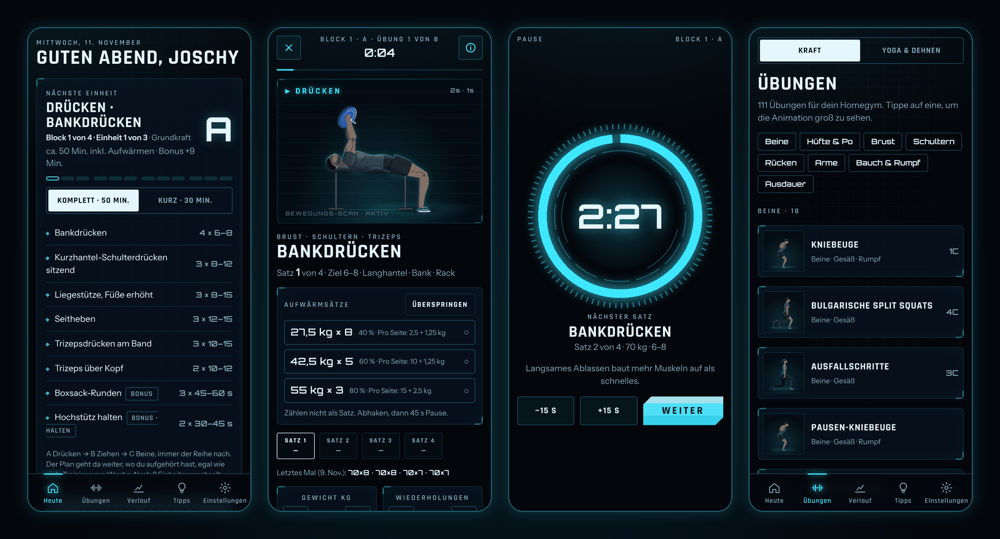
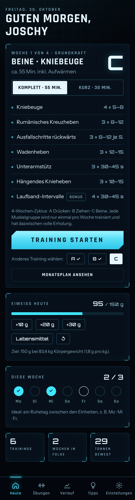
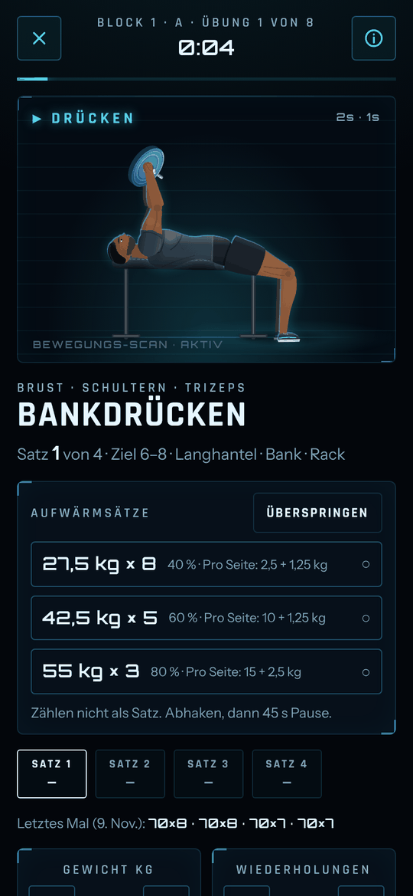
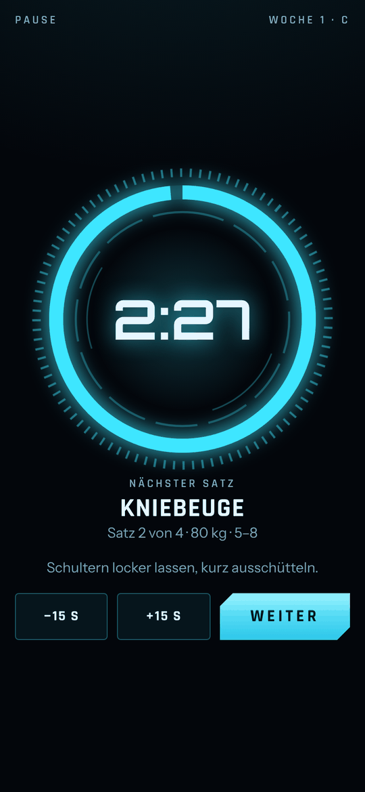
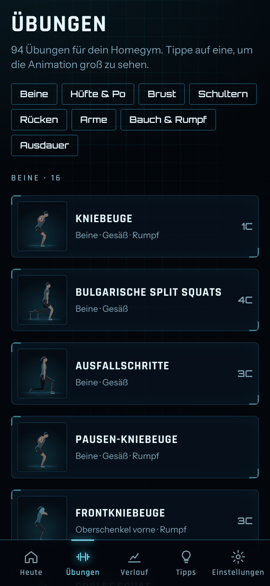
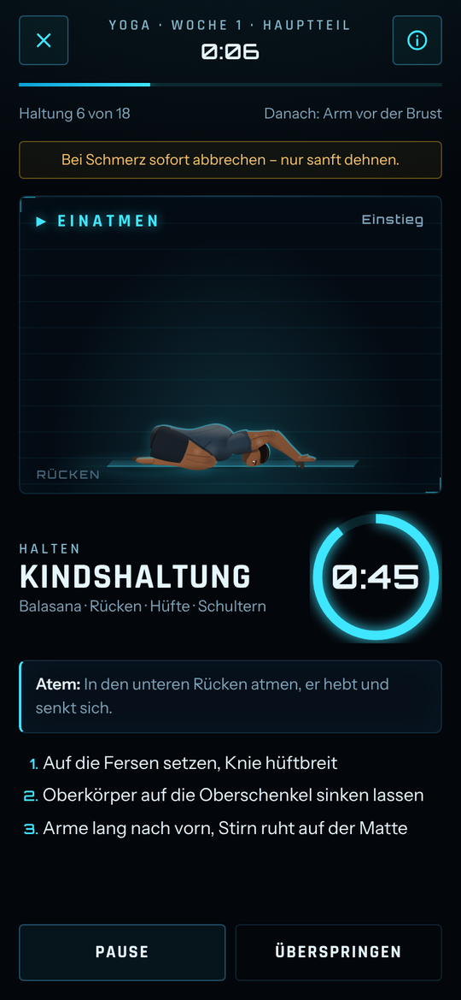
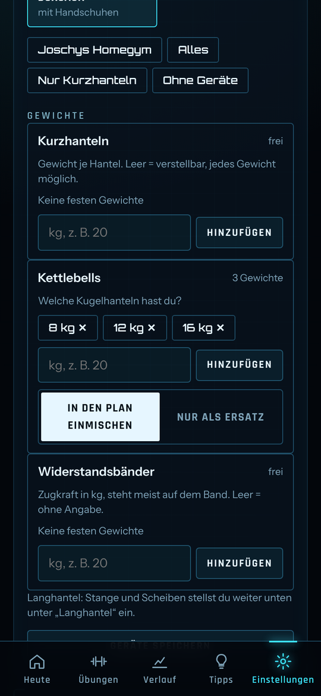

# Homegym – dein persönlicher Trainingscoach

Android-App für Krafttraining zu Hause: geführte Trainings mit animierten Übungen, Pausen-Timer und dem Sprachassistenten JAI, komplett offline.



## Was die App kann
- **4-Wochen-Trainingsplan** mit 12 Einheiten als Push/Pull/Beine-Split (A Drücken · B Ziehen · C Beine), jede Muskelgruppe mit einer Woche Erholung. Komplett- oder Kurzversion, max. 60 Minuten inkl. Aufwärmen.
- **111 animierte Kraft-Übungen** (davon 17 Halte-Übungen) mit Technik-Hinweisen; Figuren abwechselnd Mann/Frau mit menschlichen Bewegungsabläufen: weiches Tempo (1 s hoch, 2 s runter), Atmung, Gewichtsverlagerung, Hände mit Fingern und abrollende Füße.
- **Halte-Übungen und Bonus-Finisher**: jede Einheit endet mit einer Halte-Übung als Bonus, weiterhin max. 60 Minuten.
- **Anpassung an die eigenen Geräte** (25 Geräte, Presets inkl. „Joschys Homegym“): Trainings passen sich automatisch an, „Tauschen“ bietet nur machbare Übungen derselben Muskelfunktion.
- **Geräte-Editor**: Geräte jederzeit ändern, Gewichtslisten je Gerät (Kurzhanteln, Kettlebells, Bänder) für passende Gewichtsvorschläge, Kettlebells wahlweise in den Plan einmischen oder nur als Ersatz.
- **Yoga & Dehnen** als Zusatz: 56 Haltungen mit Animation und Atem-Hinweisen, jede als ganzer Weg Stehen → Haltung → Stehen, 12-Wochen-Plan in 3 Stufen, Schnell-Dehnen und Dehnen nach dem Training.
- **Animationstempo** in den Einstellungen anpassbar.
- **Pausen-Timer** mit Benachrichtigung und Bild-in-Bild-Mini-Fenster, auch wenn die App im Hintergrund ist.
- **Sprachassistent JAI**: sagt Übungen, Sätze, Gewichte, Countdown und Bestwerte an.
- **Fortschritt**: automatische Steigerungsempfehlung, Scheiben-Rechner, Verlauf mit Bestleistungen, Körpergewicht, Eiweiß-Zähler, Entlastungswoche.
- **Backup / Wiederherstellen**: alle Daten als Datei sichern und zurückspielen, auch direkt beim ersten Start (z. B. auf einem neuen Handy).
- **Offline, keine Anmeldung**: alle Daten bleiben auf dem Handy. Beim ersten Start fragt ein kurzes Onboarding Name, Gewicht, Trainingstage und Geräte ab.

## Screenshots
| Start | Training | Pause | Übungen |
|---|---|---|---|
|  |  |  |  |

| Yoga & Dehnen | Geräte-Editor |
|---|---|
|  |  |

## Installation
1. Die aktuelle APK aus dem Ordner [`releases/`](releases/) laden (aktuell `releases/Homegym-2.2.apk`).
2. Auf dem Handy öffnen und „Installation aus unbekannten Quellen“ erlauben.
3. Beim ersten Training die Benachrichtigungen zulassen.

Updates einfach drüber installieren, die Daten bleiben erhalten. Bei aggressiven Akkusparmodi: Apps → Homegym → Akku → „Nicht eingeschränkt“.

## Projektstruktur
| Ordner | Inhalt |
|---|---|
| `src/` | `app.html` (gesamte Web-App: UI, Logik, Renderer, Bewegungs-Engine), `program.js` (4-Wochen-Plan, beim Build über `/*PROGRAM*/` eingesetzt) und `yoga.js` (Yoga & Dehnen, über `/*YOGA*/` eingesetzt) |
| `java/` | Android-Hülle: `MainActivity` (WebView, Bild-in-Bild), `Bridge` (JS-Schnittstelle), `TimerService` (Foreground Service für den Pausen-Timer) |
| `android/` | apktool-Projekt: Manifest, Ressourcen, `assets/index.html`, `assets/jai/*.mp3`, kompilierte `classes.dex` |
| `tools/` | `build_html.py`, `build.sh` (kompletter Build) |
| `jai/` | Ansage-Liste (`manifest.json`), Schnitt-Skripte, Effekt-Kette, Prüftabelle der Clips |
| `tests/` | Playwright-Tests (Pläne/Geräte, UI, JAI, Hintergrund-Timer) |
| `docs/` | Prüfberichte |

## Build
Voraussetzungen: JDK, python3, npm. Die Werkzeuge (apktool 2.9.3, uber-apk-signer 1.3.0, dex2jar 2.4, android.jar API 34) nach `tools/.cache/` legen oder per Umgebungsvariable angeben, Details im Kopf von `tools/build.sh`.

```bash
tools/build.sh fonts   # Schriften per npm holen (einmalig)
tools/build.sh         # -> out/index.html und dist/Homegym.apk
```

Die Java-Klassen werden mit `--release 8` kompiliert (keine Lambdas), damit `dx` sie für minSdk 24 übersetzen kann.

## Tests
Benötigt Python-Playwright mit Chromium. Nach dem Build:

```bash
python3 tests/t17g.py    # Pläne, Geräte-Anpassung, Muskeltrennung
python3 tests/t17ui.py   # UI-Ablauf
python3 tests/t19.py     # JAI-Ansagen (lädt out/ über einen lokalen HTTP-Server)
python3 tests/t20.py     # Hintergrund-Timer/Bild-in-Bild mit nachgebildeter Android-Bridge
python3 tests/t21.py     # Halte-Übungen, Bonus-Finisher, 60-Minuten-Grenze, Geräte-Editor, Backup
python3 tests/t22.py     # Yoga & Dehnen: Haltungen, 12-Wochen-Plan, Ablauf, Bibliothek, Backup
python3 tests/t23.py     # Natürliche Bewegungen: Tempo, Atmung, Gelenke, Hände/Füße, Animationstempo
python3 tests/t24.py     # Yoga als Schleife: Stehen → Haltung → Stehen
python3 tests/t25.py     # Weiche Stopps, Katze-Kuh, Halber Bogen, Kraftübungen
```

Screenshots landen in `/tmp/homegym-shots/` (änderbar über `HOMEGYM_SHOTS`).

## JAI-Stimme
JAI („Joschy's AI“) ist eine eigene, mit ElevenLabs entworfene Stimme (keine Nachbildung einer realen Person). Die 276 Ansagen wurden einmalig erzeugt, mit `jai/split.py` geschnitten, mit der Effekt-Kette „leicht“ aus `jai/fx.md` bearbeitet und liegen fertig in `android/assets/jai/`. Die App setzt sie zur Laufzeit zusammen, etwa Zahl + „Komma fünf“ + „Kilo“.

## Versionen
Aktuell: **2.2**. Details in [CHANGELOG.md](CHANGELOG.md).

| Version | Wichtigste Neuerungen |
|---|---|
| 2.2 | Menschlichere Bewegungen (Tempo, Atmung, Hände/Füße), Yoga als ganzer Weg Stehen → Pose → Stehen, Einstellung Animationstempo |
| 2.1 | Halte-Übungen + Bonus-Finisher, Geräte-Editor mit Gewichtslisten, Backup/Wiederherstellen, Yoga & Dehnen |
| 2.0 | Pausen-Timer im Hintergrund (Benachrichtigung), Bild-in-Bild, neue Android-Hülle |
| 1.9 | Sprachassistent JAI |
| 1.8 | Neue Bewegungs-Engine |
| 1.7 | 25 Geräte, 94 Übungen, neue Figuren |
| 1.6 | Geräteauswahl, Trainings passen sich an |
| 1.4 | 4-Wochen-Zyklus Push/Pull/Beine |
| 1.0 | Erste Version |

---

@ Joschy
