# Homegym – dein persönlicher Trainingscoach

## Download

**[Homegym 3.4 herunterladen (APK, ca. 3 MB)](https://github.com/jr-stack-bot/homegym-app/raw/main/releases/Homegym-3.4.apk)**

Auf dem Android-Handy antippen, Datei öffnen und die Installation aus unbekannter Quelle einmalig erlauben. Ab Android 7.

Android-App für Krafttraining zu Hause: geführte Trainings mit animierten Übungen, Pausen-Timer und dem Sprachassistenten JAI, komplett offline.

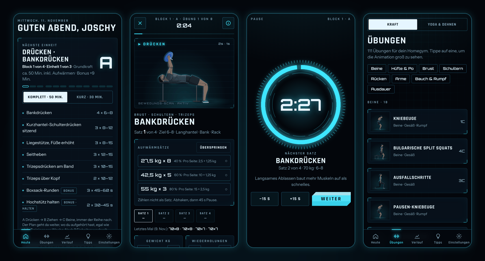

## Was die App kann
- **4-Wochen-Trainingsplan** mit 12 Einheiten, der **nach erledigten Einheiten** weiterläuft (keine Einheit fällt aus, leichter Wiedereinstieg nach 14 Tagen Pause), als Push/Pull/Beine-Split (A Drücken · B Ziehen · C Beine), jede Muskelgruppe mit einer Woche Erholung. Komplett- oder Kurzversion, max. 60 Minuten inkl. Aufwärmen.
- **259 animierte Kraft-Übungen** mit Technik-Hinweisen; Figuren abwechselnd Mann/Frau mit menschlichen Bewegungsabläufen: weiches Tempo (1 s hoch, 2 s runter), Atmung, Gewichtsverlagerung, Hände mit Fingern und abrollende Füße.
- **Halte-Übungen und Bonus-Finisher**: jede Einheit endet mit einer Halte-Übung als Bonus, weiterhin max. 60 Minuten.
- **Anpassung an die eigenen Geräte** (25 Geräte, Presets inkl. „Joschys Homegym“): Trainings passen sich automatisch an, „Tauschen“ bietet nur machbare Übungen derselben Muskelfunktion.
- **Geräte-Editor**: Geräte jederzeit ändern, Gewichtslisten je Gerät (Kurzhanteln, Kettlebells, Bänder) für passende Gewichtsvorschläge, Kettlebells wahlweise in den Plan einmischen oder nur als Ersatz.
- **Yoga & Dehnen** als Zusatz: **154 Haltungen in drei Stufen** (Anfänger, Fortgeschritten, Profi) mit Animation und Atem-Hinweisen, beim Wiederholen einer Woche wechseln Haltungen, Knopf „Andere Haltung“, jede als ganzer Weg Stehen → Haltung → Stehen; 24-Wochen-Plan mit einer Einheit pro Woche, **Startstufe wählbar** (Profi erst nach Sicherheitsabfrage), bei Profi-Haltungen **Sicherheits-Hinweise** und eine **leichtere Variante** auf Knopfdruck; Schnell-Dehnen und Dehnen nach dem Training.
- **41 neue Übungen ohne Geräte** in den Stufen leicht / mittel / schwer, teils mit Alltagsgegenständen (Wand, Stuhl, Tisch, Handtuch, Rucksack, Wasserflaschen); die Steigerung schlägt die nächst schwerere Variante vor, das Preset „Ohne Geräte“ bietet 12 abwechslungsreiche Einheiten.
- **Griffkraft & Hängen**: Block am Zieh-Tag in 4 Stufen bis zum Handtuch-Hang (Zeit steigt automatisch), Farmer's Hold am Beintag, Hang-Test alle 4 Wochen mit Kurve (Ziel 1–2 Minuten frei hängen) und freiwillige Hang-Pause an freien Tagen.
- **Animationstempo** in den Einstellungen anpassbar.
- **8 Designs zur Auswahl** (Arc Blau, Iron Man, Toxic, Cyber, Sunset, Eis, Stealth, Tag): eigene Farbwelt, Hintergrund-Effekt, Rahmenform und Schrift, Figuren in der Akzentfarbe; Status- und Navigationsleiste passen sich an, Effekte pausieren im Training und bei „Bewegung reduzieren“.
- **Pausen-Timer** mit Benachrichtigung und Bild-in-Bild-Mini-Fenster, auch wenn die App im Hintergrund ist.
- **Sprachassistent JAI**: sagt Übungen, Sätze, Gewichte, Countdown und Bestwerte an.
- **Klügere Steigerung**: nach dem letzten Satz kurz „leicht / passend / hart“ angeben, die nächsten Vorschläge kommen mit Begründung; nach 3 Einheiten ohne Fortschritt ein Plateau-Vorschlag (Gewicht −10 %, neues Ziel oder Variante).
- **Aufwärmsätze** vor der ersten Hauptübung mit Scheibenanzeige pro Seite.
- **Auswertung** mit fünf Bereichen: Kraft (geschätzte Maximalkraft mit Kurve), Muskeln (Sätze pro Muskelgruppe mit Plan-Soll), Kalender mit Serien, Körpermaße und Monatsbericht.
- **Fortschritt**: Scheiben-Rechner, Verlauf mit Bestleistungen, Körpergewicht, Eiweiß-Zähler, Entlastungswoche.
- **Backup / Wiederherstellen**: alle Daten (inkl. Plan-Stand, Anstrengung, Aufwärmsätze, Körpermaße) als Datei sichern und zurückspielen, ältere Backups bleiben lesbar, auch direkt beim ersten Start (z. B. auf einem neuen Handy).
- **Offline, keine Anmeldung**: alle Daten bleiben auf dem Handy. Beim ersten Start fragt ein kurzes Onboarding Name, Gewicht, Trainingstage und Geräte ab.

## Screenshots
| Start | Training | Pause | Übungen |
|---|---|---|---|
| 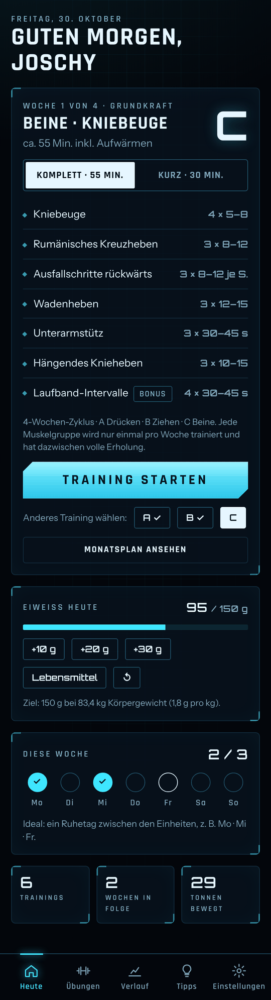 | 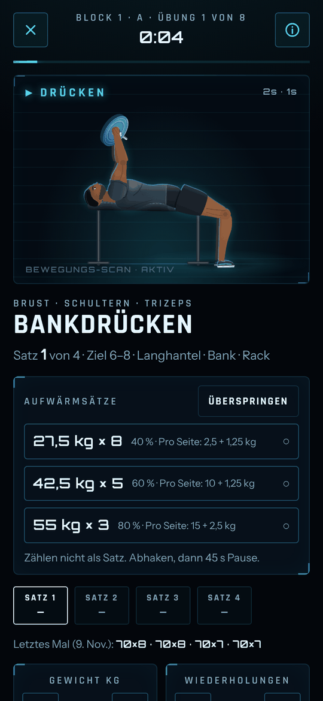 | 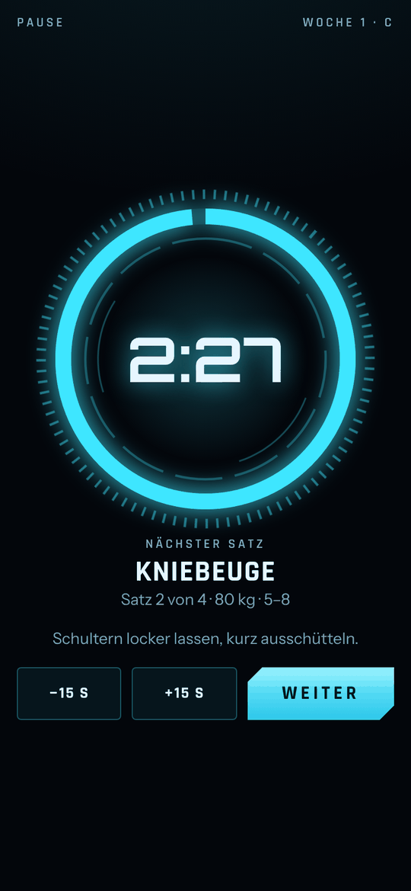 | 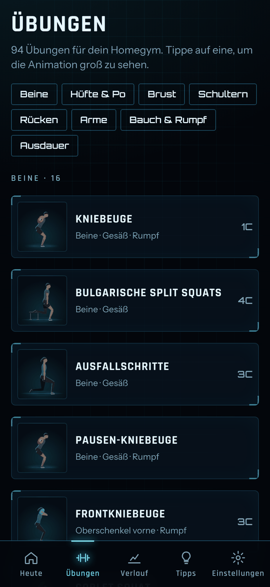 |

| Yoga & Dehnen | Geräte-Editor | Designs |
|---|---|---|
| 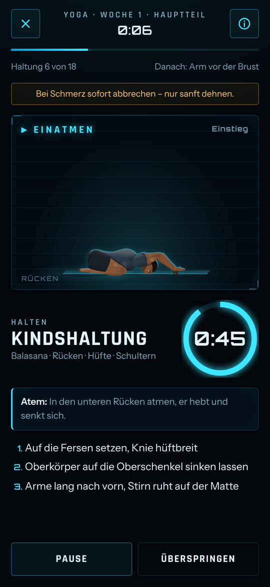 | 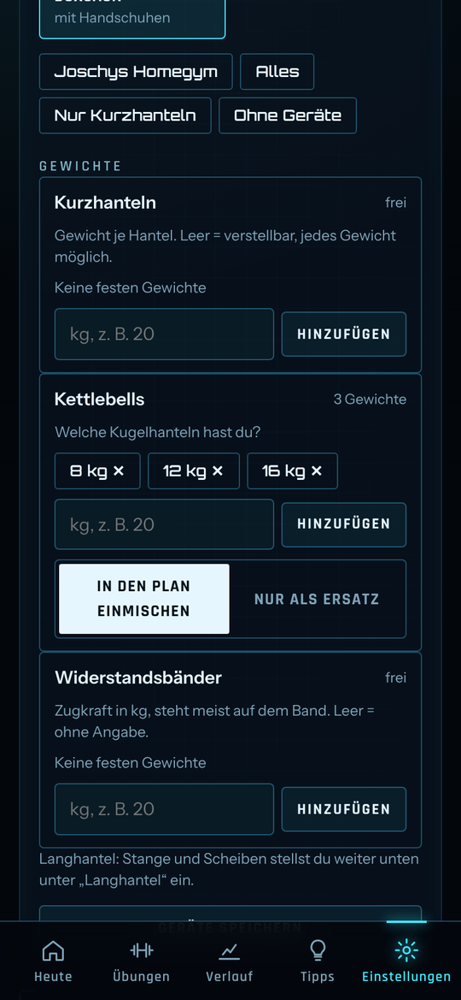 | 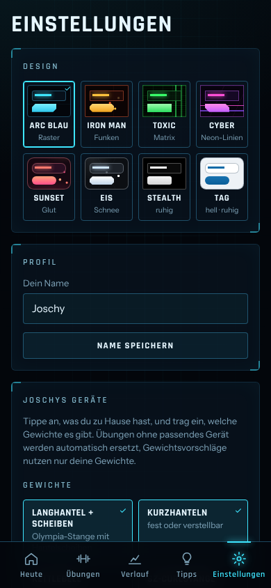 |

| Auswertung | Aufwärmsätze & Steigerung | Figuren |
|---|---|---|
| 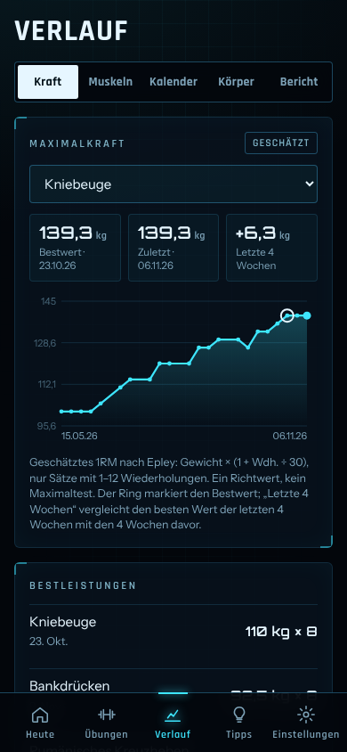 | 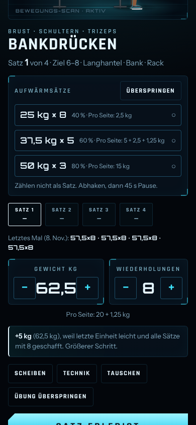 | 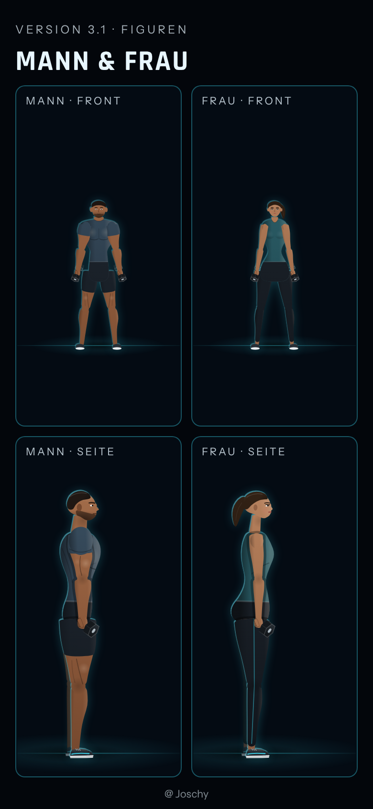 |

| Yoga in drei Stufen | Ohne Geräte | Griffkraft & Hängen | Hang-Test |
|---|---|---|---|
| 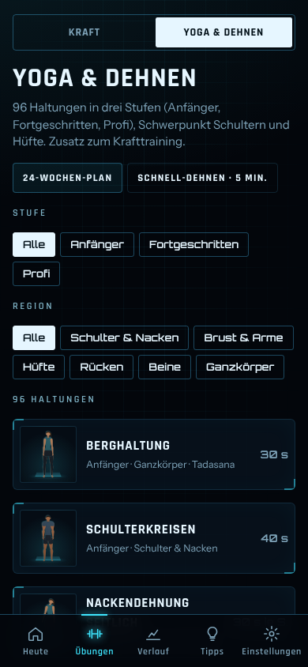 | 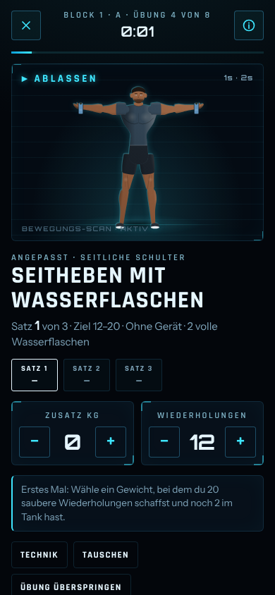 | 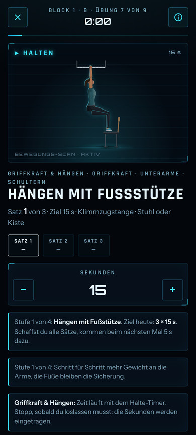 | 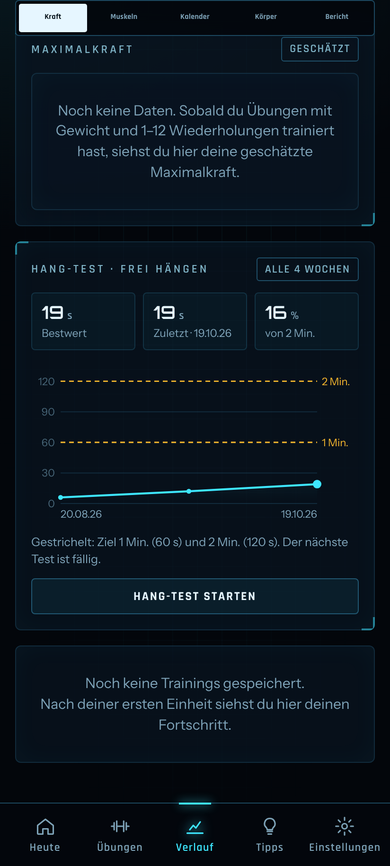 |

**Alle 8 Designs im Vergleich** (Startseite: Arc Blau, Iron Man, Toxic, Cyber, Sunset, Eis, Stealth, Tag):

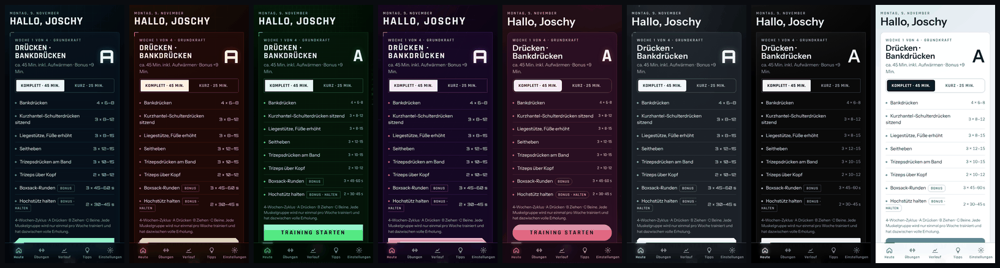

## Installation
1. Die APK über den [Download-Link ganz oben](https://github.com/jr-stack-bot/homegym-app/raw/main/releases/Homegym-3.4.apk) laden (aktuell Version 3.4; ältere Versionen liegen im Ordner [`releases/`](releases/)).
2. Auf dem Handy öffnen und „Installation aus unbekannten Quellen“ erlauben.
3. Beim ersten Training die Benachrichtigungen zulassen.

Updates einfach drüber installieren, die Daten bleiben erhalten. **Vor dem Update ein Backup erstellen** (Einstellungen → Backup), damit nichts verloren gehen kann. Bei aggressiven Akkusparmodi: Apps → Homegym → Akku → „Nicht eingeschränkt“.

## Projektstruktur
| Ordner | Inhalt |
|---|---|
| `src/` | `app.html` (gesamte Web-App: UI, Logik, Renderer, Bewegungs-Engine), `program.js` (4-Wochen-Plan, beim Build über `/*PROGRAM*/` eingesetzt), `yoga.js` (Yoga & Dehnen, über `/*YOGA*/` eingesetzt), `hang.js` (Griffkraft & Hängen, über `/*HANG*/` eingesetzt) und `kraft.js` (100 zusätzliche Kraftübungen, über `/*KRAFT*/` eingesetzt) |
| `java/` | Android-Hülle: `MainActivity` (WebView, Bild-in-Bild, Systemleisten-Farben), `Bridge` (JS-Schnittstelle), `TimerService` (Foreground Service für den Pausen-Timer) |
| `android/` | apktool-Projekt: Manifest, Ressourcen, `assets/index.html`, `assets/jai/*.mp3`, kompilierte `classes.dex` |
| `tools/` | `build_html.py`, `build.sh` (kompletter Build) |
| `jai/` | Ansage-Liste (`manifest.json`), Schnitt-Skripte, Effekt-Kette, Prüftabelle der Clips |
| `tests/` | Playwright-Tests (Pläne/Geräte, UI, JAI, Hintergrund-Timer) |
| `docs/` | Prüfberichte, Screenshots |

## Build
Voraussetzungen: JDK, python3, npm. Die Werkzeuge (apktool 2.9.3, uber-apk-signer 1.3.0, dex2jar 2.4, android.jar API 34) nach `tools/.cache/` legen oder per Umgebungsvariable angeben, Details im Kopf von `tools/build.sh`.

```bash
tools/build.sh fonts   # Schriften per npm holen (einmalig)
tools/build.sh         # -> out/index.html und dist/Homegym.apk
```

Bei jeder neuen Version den Download-Link oben im README auf die neue APK ändern.

Die Java-Klassen werden mit `--release 8` kompiliert (keine Lambdas), damit `dx` sie für minSdk 24 übersetzen kann.

## Tests
Benötigt Python-Playwright mit Chromium. Nach dem Build:

```bash
python3 tests/t17g.py    # Pläne, Geräte-Anpassung, Muskeltrennung
python3 tests/t17ui.py   # UI-Ablauf
python3 tests/t19.py     # JAI-Ansagen (lädt out/ über einen lokalen HTTP-Server)
python3 tests/t20.py     # Hintergrund-Timer/Bild-in-Bild mit nachgebildeter Android-Bridge
python3 tests/t21.py     # Halte-Übungen, Bonus-Finisher, 60-Minuten-Grenze, Geräte-Editor, Backup
python3 tests/t22.py     # Yoga & Dehnen: Haltungen, 24-Wochen-Plan, Ablauf, Bibliothek, Backup
python3 tests/t23.py     # Natürliche Bewegungen: Tempo, Atmung, Gelenke, Hände/Füße, Animationstempo
python3 tests/t24.py     # Yoga als Schleife: Stehen → Haltung → Stehen
python3 tests/t25.py     # Weiche Stopps, Katze-Kuh, Halber Bogen, Kraftübungen
python3 tests/t26.py     # Designs: 8 Themes, Live-Vorschau, Speichern, Backup, Kontrast, Effekte
python3 tests/t27.py     # Plan nach Einheiten, Migration, Wiedereinstieg, Anstrengung, Plateau, Aufwärmsätze, Backup
python3 tests/t28.py     # Auswertung: Kraft/1RM, Muskeln, Kalender/Serien, Körpermaße, Monatsbericht
python3 tests/t29.py     # Figuren: Vergleich mit 3.0 (Gelenke/Griffpunkte gleich, Kinn, Proportionen, Tempo)
python3 tests/t30.py     # Yoga in 3 Stufen, 24-Wochen-Plan, Startstufe, Übernahme aus 3.1, Profi-Sicherheit, Übungen ohne Geräte, Hauptübungen wie in 3.1
python3 tests/t32.py     # Griffkraft & Hängen: Stufen, Hang-Test, Hang-Pause, Farmer's Hold, 60-Minuten-Grenze, Migration, Backup
```

`t29` vergleicht mit dem eingefrorenen 3.0-Stand in `tests/fixtures/v30/index.html`, `t30` mit dem 3.1-Stand in `tests/fixtures/v31/index.html`, `t32` zusätzlich mit dem 3.2-Stand in `tests/fixtures/v32/index.html` (Details in `tests/fixtures/README.txt`, andere Ordner per `HOMEGYM_V30` / `HOMEGYM_V31` / `HOMEGYM_V32`).

Screenshots landen in `/tmp/homegym-shots/` (änderbar über `HOMEGYM_SHOTS`).

## JAI-Stimme
JAI („Joschy's AI“) ist eine eigene, mit ElevenLabs entworfene Stimme (keine Nachbildung einer realen Person). Die 276 Ansagen wurden einmalig erzeugt, mit `jai/split.py` geschnitten, mit der Effekt-Kette „leicht“ aus `jai/fx.md` bearbeitet und liegen fertig in `android/assets/jai/`. Die App setzt sie zur Laufzeit zusammen, etwa Zahl + „Komma fünf“ + „Kilo“.

## Versionen
Aktuell: **3.4**. Details in [CHANGELOG.md](CHANGELOG.md).

| Version | Wichtigste Neuerungen |
|---|---|
| 3.4 | 58 neue Yoga-Haltungen (154), Rotation beim Wiederholen einer Woche, „Andere Haltung“, Dehn-Abläufe wechseln wöchentlich; 100 neue Kraftübungen (259) auf Nebenplätzen in jedem zweiten Zyklus und bei „Tauschen“, Hauptübungen unverändert; Übungsblatt mit Atmung/Leichter/Achtung; Geräte- und Layout-Fixes |
| 3.3 | Griffkraft & Hängen: Block am Zieh-Tag in 4 Stufen, Farmer's Hold am Beintag, Hang-Test alle 4 Wochen mit Kurve, Hang-Pause an freien Tagen; Anzeige-Fixes (nichts abgeschnitten, 360 px/große Schrift, Halte-Übungen mit Haltezeit) |
| 3.2 | Yoga mit 96 Haltungen in drei Stufen (Anfänger/Fortgeschritten/Profi), 24-Wochen-Plan, Startstufe wählbar, Sicherheits-Hinweise und leichtere Variante; 41 neue Übungen ohne Geräte (leicht/mittel/schwer), Preset „Ohne Geräte“ mit 12 abwechslungsreichen Einheiten |
| 3.1 | Figuren überarbeitet: Frau ohne Kinnschatten, weiblicheres Gesicht und Proportionen, natürlicher Pferdeschwanz; Mann athletischer mit Muskelzeichnung; Bewegungen unverändert |
| 3.0 | Klügere Steigerung (leicht/passend/hart, Plateau-Vorschlag), Plan nach erledigten Einheiten, Aufwärmsätze mit Scheibenanzeige, Auswertung mit fünf Bereichen |
| 2.3 | Acht Designs zur Auswahl (eigene Farbwelt, Effekt, Rahmen, Schrift), Status-/Navigationsleiste passt sich an |
| 2.2 | Menschlichere Bewegungen (Tempo, Atmung, Hände/Füße), Yoga als ganzer Weg Stehen → Pose → Stehen, Einstellung Animationstempo |
| 2.1 | Halte-Übungen + Bonus-Finisher, Geräte-Editor mit Gewichtslisten, Backup/Wiederherstellen, Yoga & Dehnen |
| 2.0 | Pausen-Timer im Hintergrund (Benachrichtigung), Bild-in-Bild, neue Android-Hülle |
| 1.9 | Sprachassistent JAI |
| 1.8 | Neue Bewegungs-Engine |
| 1.7 | 25 Geräte, 94 Übungen, neue Figuren |
| 1.6 | Geräteauswahl, Trainings passen sich an |
| 1.4 | 4-Wochen-Zyklus Push/Pull/Beine |
| 1.0 | Erste Version |

---

@ Joschy
